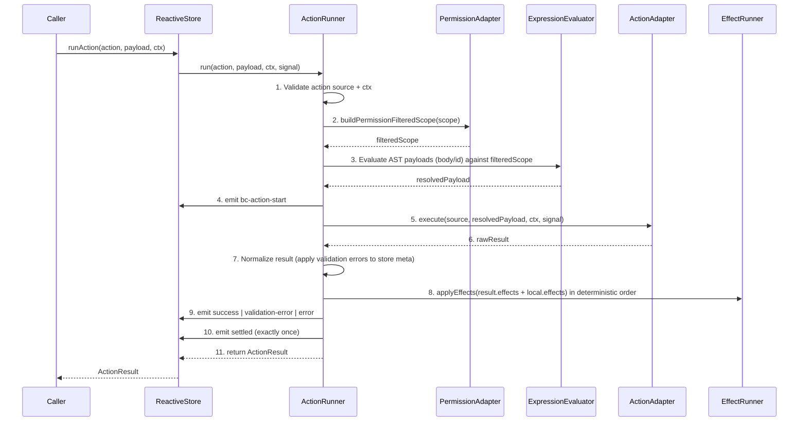
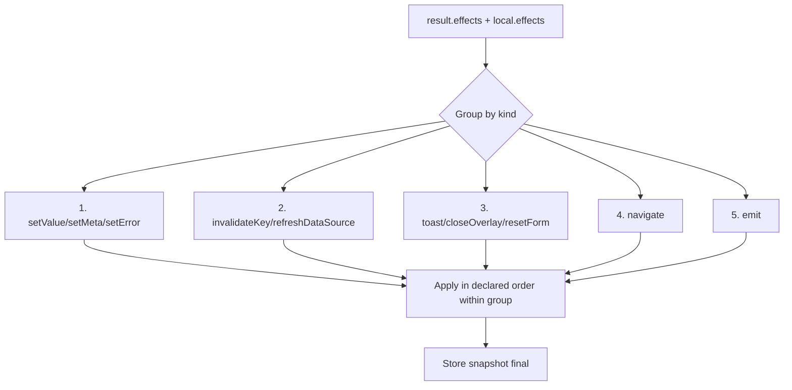

# Block Catalog Action & Expression Runtime — Implementation Notes

Status: Design spike / implementation notes (Agent E)
Date: 2026-06-30
Architecture baseline: ADR-017 and ADR-018 Accepted
Scope owner: P2 (Portable Expression AST) + P3 (ActionRunner / effects / lifecycle)
Sibling dependency: Agent A owns `@bitcode/ui-schema` foundation types (P1). This doc does NOT modify Agent A's public runtime APIs until P1 types are merged; isolated fixtures and design notes only.

> This document is the **execution design for P2 and P3** of `docs/plans/block-catalog-implementation.md`. It gives implementators an exact, dependency-ordered path to deliver:
>
> - Portable Expression AST evaluators (TypeScript + Dart) with shared golden fixtures.
> - A versioned built-in function registry with platform parity manifests.
> - `ActionRunner` + `ReactiveStore.runAction` integration (TS + Dart).
> - Deterministic effect application, lifecycle events / notifiers, and permission-filtered scopes.
>
> It is intentionally docs-first. Any code shown is either (a) type-shape proposals to align implementators, or (b) isolated test fixtures clearly marked non-runtime. No public runtime API is locked until Agent A's `ui-schema` types are merged.

---

## 1. Existing code map

Audit of every piece of infrastructure P2/P3 must build on or stay consistent with. All paths are repo-relative unless noted.

### 1.1 TypeScript — `@bitcode/ui-schema` (canonical portable types)

| Concern | File | Notes for P2/P3 |
|---|---|---|
| Root barrel | `packages/ui-schema/src/index.ts` | P2/P3 must add new export subpaths (`./expressions`, `./actions`, `./runtime`) here **without** disturbing existing `./reactive`, `./schema`, `./block-catalog` exports. Agent A already added `./block-catalog` subpath in `package.json`. |
| Shared types | `packages/ui-schema/src/types.ts` | Defines `DataSource`, `FetchParams`, `FetchResult`, `ModelAdapter`, `BcChangeMeta`, event types. P3 `ActionSource` is the **write mirror** of `DataSource`; keep the discriminated-union shape consistent. |
| Reactive engine | `packages/ui-schema/src/reactive/types.ts` | Defines `Reaction`, `Effect`, `FieldMeta`, `Snapshot`, **`Evaluator`** (string-based plug-in slot), `ReactiveScopeLike`. **Critical gap:** `Evaluator` is string-based; ADR-018 §5 mandates a structured Portable Expression AST. P2 must introduce a parallel `ExpressionEvaluator` (AST-based) without removing the existing string `Evaluator` (escape hatch). |
| Reactive store | `packages/ui-schema/src/reactive/store.ts` | `ReactiveStore` class. Has `set/setMany/get/getMeta/snapshot/subscribe/runAll/evaluate`. **No `runAction` method yet.** P3 adds `runAction(action, payload, ctx)` following ADR-018 §8 execution order. Has nested-scope support (`$self/$parent/$root/$index`). |
| Schema types | `packages/ui-schema/src/schema/types.ts` | `UiSchema`, `FieldNode`, `UiAction` (button descriptor — ADR-018 amends it into a mutation protocol). **P3 must NOT remove `UiAction`'s existing button fields; it extends, not replaces.** |
| Resolver | `packages/ui-schema/src/schema/resolver.ts` | `resolveField` / `resolveFieldType`. Not touched by P2/P3. |
| Block catalog (Agent A, P1) | `packages/ui-schema/src/block-catalog/{types,capability,validate,fixtures,index}.ts` | `BlockCatalogEntry`, `CandidateCatalogEntry`, policies, `validateBlockCatalogEntry`, `BLOCK_DIAGNOSTIC_CODES`, candidate fixtures. **P2/P3 must add diagnostic codes prefixed `BLOCK_EXPR_*` / `BLOCK_ACTION_*` in a separate code space** (do not mutate Agent A's `BLOCK_*` set; extend via a registry). |

### 1.2 TypeScript — `@bitcode/ui` (web implementation)

| Concern | File | Notes for P2/P3 |
|---|---|---|
| Reactive re-export | `packages/ui/src/core/reactive/{store,types,index}.ts` | Thin re-exports from `@bitcode/ui-schema` for backwards compat. P3 `runAction` will be available transitively; no new re-export needed unless web adds host adapters. |
| Data source | `packages/ui/src/core/data-source.ts` | `resolveDataSource(source, params)` — 4-layer resolver with retry/abort. **P3 `url`/`model` ActionSource adapters can reuse the retry/backoff/abort plumbing here** (`withRetry`, `backoff`, `appendParams`). Read mirror; do not couple action runner to read path. |
| Context (singleton config) | `packages/ui/src/core/context.ts` | `configure()`, `getBaseUrl()`, `getHeaders()`, `getModelAdapter()`. **ADR-018 §7 forbids mutable singleton registries as a hard requirement for ActionRuntimeContext.** P3 keeps this for legacy read paths but the action runtime uses an explicit per-instance `ActionRuntimeContext`. Host apps may seed the context from the singleton, but `ActionRunner` reads only from the passed context. |
| WC event bridge | `packages/ui/src/core/wc-event-bridge.ts` | `dispatchBcEvent`, `buildMeta`, `BC_EVENTS` map (kebab-case `bc-*` names). **P3 lifecycle events `bc-action-start/success/error/validation-error/settled` extend this map.** Dispatch helper is already SSR-safe (no-ops when `document`/`CustomEvent` unavailable). |
| Registry | `packages/ui/src/core/registry.ts` | Component registry pattern. Reference for how P4 block component registry should look; P2/P3 does not touch it. |

### 1.3 Dart — `packages/ui-flutter`

| Concern | File | Notes for P2/P3 |
|---|---|---|
| Reactive store (pure Dart) | `packages/ui-flutter/lib/src/core/reactive_store.dart` | Full Dart port of `ReactiveStore` (ADR-011 §4 Layer 1). Has `set/setMany/get/getMeta/snapshot/subscribe/runAll/evaluate`. **No `runAction` yet.** `Evaluator` is abstract class (string-based) — P2 adds AST evaluator as a separate class implementing a new `ExpressionEvaluator` abstract. |
| Reactive notifier (Flutter bridge) | `packages/ui-flutter/lib/src/core/reactive_store_notifier.dart` | `ReactiveStoreNotifier extends ChangeNotifier` — the ONLY Flutter-importing piece of the reactive engine. **P3 action lifecycle uses Dart `Stream<ActionLifecycleEvent>` notifiers here, paralleling web CustomEvents.** Keeps business logic pure-Dart. |
| Data source loader | `packages/ui-flutter/lib/src/renderer/bc_data_source_loader.dart` | `loadDataSource(source, {params, client})` — 4-layer resolver. All errors captured into `FetchResult.error` (never thrown). **P3 `url`/`model` action adapters reuse this error-capture discipline and the injectable `http.Client` pattern for deterministic tests.** |
| Schema types (freezed) | `packages/ui-flutter/lib/src/schema/ui_schema_types.dart`, `ui_schema.dart`, `ui_schema_events.dart` | Freezed + json_serializable ports. **P2/P3 Dart types should follow the same freezed pattern** (sealed unions for `ActionSource`, `PortableExpression`, `ActionEffect`; `@JsonSerializable(explicitToJson: true)`). Generated `.freezed.dart` / `.g.dart` must be committed. |
| Field resolver | `packages/ui-flutter/lib/src/schema/field_resolver.dart` | Not touched. |
| Core types | `packages/ui-flutter/lib/src/core/types.dart` (29KB) | Large shared type surface. P2/P3 adds new files, does not bloat this file. |
| Tests | `packages/ui-flutter/test/reactive_store_test.dart` (211 lines), `types_test.dart`, `schema/`, `renderer/`, `fixtures/`, `helpers/` | Established test conventions: `flutter_test`, group/test structure, `FakeAsync` for timers, fake webview platform for chart parity. **P2/P3 golden fixtures go in `test/fixtures/expressions/` (shared JSON) + `test/expressions/` (Dart runners).** |

### 1.4 Reference: go-json expression engine (pattern source, NOT a dependency)

| Concern | File | Reusable patterns |
|---|---|---|
| Expr engine abstraction | `packages/go-json/lang/expr_engine.go` | `ExprEngine` interface + `ExprLangEngine` (expr-lang wrapper). **P2 does NOT wrap expr-lang** (ADR-018 §5 mandates pure structured AST for Ready behavior). But the **error enrichment pattern** (`enrichError`, `UNDEFINED_VAR`/`TYPE_MISMATCH`/`DIVISION_BY_ZERO` codes, suggestion engine `SuggestSimilar`) is a strong reference for P2 typed expression errors. |
| AST | `packages/go-json/lang/ast.go` | Node types, visitor pattern. Reference for AST shape discipline; P2 AST is much smaller (5 node kinds). |
| Errors | `packages/go-json/lang/errors.go` | `GoJSONError` with code/context/suggestions/fix. Reference for P2 `ExpressionError` shape. |

### 1.5 Event bridge parity summary

| Concern | TypeScript (web) | Dart (Flutter) |
|---|---|---|
| Dispatch primitive | `dispatchBcEvent(host, name, value, meta)` → `CustomEvent` | `Stream<ActionLifecycleEvent>` via `ReactiveStoreNotifier` |
| Naming | kebab-case `bc-action-start` | typed enum / class field |
| SSR safety | no-ops when `document` unavailable | N/A (Dart) |
| Payload | `ActionLifecycleEvent` interface | `ActionLifecycleEvent` freezed class (must match field-for-field) |

---

## 2. Proposed file layout

Exact target filenames. Package boundaries are mandatory (plan §3). P2/P3 do not bleed across packages.

### 2.1 `packages/ui-schema` (canonical portable contracts — Agent A coordination zone)

```
packages/ui-schema/src/
├── expressions/                          # P2 — NEW
│   ├── index.ts                          # barrel
│   ├── ast.ts                            # PortableExpression union (5 node kinds)
│   ├── operators.ts                      # PortableOperator enum + arity/type tables
│   ├── errors.ts                         # ExpressionError codes + node-path tracking
│   ├── scope.ts                          # ExpressionScope shape (values/meta/data/services/permissions/args)
│   ├── permission-scope.ts              # buildPermissionFilteredScope() — removes unauthorized fields BEFORE eval
│   ├── evaluator.ts                      # ExpressionEvaluator interface (AST-based, pure)
│   ├── function-registry.ts             # FunctionRegistry, FunctionManifestEntry, register/lookup/manifest-validate
│   ├── builtin-manifest.ts              # Static manifest of built-in functions (math/string/array/date/format/validate)
│   └── golden-types.ts                  # GoldenFixture, GoldenCase types (shared with Dart)
├── actions/                              # P3 — NEW
│   ├── index.ts                          # barrel
│   ├── source.ts                         # ActionSource union (local/handler/url/model)
│   ├── result.ts                         # ActionResult, ActionError
│   ├── effect.ts                         # ActionEffect union (10 effect kinds v1)
│   ├── lifecycle.ts                      # ActionLifecycleEvent, ActionPhase
│   ├── adapter.ts                        # ActionAdapter interface, ActionAdapterRegistry
│   ├── runtime-context.ts               # ActionRuntimeContext, adapter registries shape
│   └── diagnostic-codes.ts              # BLOCK_EXPR_* / BLOCK_ACTION_* codes (separate space from Agent A's BLOCK_*)
├── runtime/                              # P3/P4 — NEW (shared runtime context bridge)
│   └── index.ts                          # re-export ActionRuntimeContext + permission-filtered scope
├── index.ts                              # + exports for ./expressions, ./actions, ./runtime
└── ... (existing files untouched)
```

`package.json` exports to add (Agent A merges after P1):
```json
"./expressions": { "types": "./src/expressions/index.ts", "default": "./src/expressions/index.ts" },
"./actions": { "types": "./src/actions/index.ts", "default": "./src/actions/index.ts" },
"./runtime": { "types": "./src/runtime/index.ts", "default": "./src/runtime/index.ts" }
```

### 2.2 `packages/ui` (web implementation)

```
packages/ui/src/core/
├── expressions/                          # P2 — NEW
│   ├── evaluator.ts                      # TypeScript ExpressionEvaluator (AST-based, pure)
│   ├── builtins/                         # built-in function implementations
│   │   ├── index.ts                      # register all namespaces
│   │   ├── math.ts                       # math.* (abs, ceil, floor, round, min, max, pow, sqrt, mod, ...)
│   │   ├── string.ts                     # string.* (concat, upper, lower, trim, split, contains, startsWith, endsWith, substring, replace, padLeft, padRight, slugify, ...)
│   │   ├── array.ts                      # array.* (sum, count, min, max, avg, filter, map, reduce, find, includes, sort, slice, compact, ...)
│   │   ├── date.ts                       # date.* (now, parse, format, addDuration, diff, startOfDay, ... — TZ-declared)
│   │   ├── format.ts                     # format.* (number, bytes, percent, date — locale-declared + fallback)
│   │   └── validate.ts                   # validate.* (isEmail, isURL, isUUID, isIP, isNumeric, ...)
│   ├── permission-scope.ts              # buildPermissionFilteredScope() TS impl
│   └── index.ts                          # barrel + createExpressionEvaluator()
├── actions/                              # P3 — NEW
│   ├── runner.ts                         # ActionRunner (orchestrates ADR-018 §8 order)
│   ├── effect-runner.ts                  # applyEffects() in deterministic order
│   ├── lifecycle.ts                      # emitActionLifecycle() via wc-event-bridge
│   ├── adapters/                         # ActionAdapter implementations
│   │   ├── index.ts                      # ActionAdapterRegistry + register
│   │   ├── local-adapter.ts             # local ActionSource → runs ActionEffect[] directly
│   │   ├── url-adapter.ts               # url ActionSource → fetch with timeout/abort/idempotency
│   │   ├── model-adapter.ts             # model ActionSource → delegates to registered ModelAdapter
│   │   └── mock-adapter.ts              # demo/test adapter (NOT for Ready production)
│   ├── redact.ts                         # redactSensitiveFields() for logs/lifecycle
│   └── index.ts                          # barrel + createActionRunner()
└── runtime/                              # P3/P4 — NEW
    └── runtime-context.ts               # createRuntimeContext() factory, validators
```

Test fixtures (shared, see §2.4):
```
packages/ui/src/core/expressions/__fixtures__/golden/   # symlink or copy of shared fixtures
packages/ui/test/expressions/                            # TS evaluator tests
packages/ui/test/actions/                                 # TS action tests
```

### 2.3 `packages/ui-flutter` (Dart parity)

```
packages/ui-flutter/lib/src/
├── expressions/                          # P2 — NEW
│   ├── ast.dart                          # PortableExpression sealed class (freezed)
│   ├── operators.dart                    # PortableOperator enum
│   ├── errors.dart                       # ExpressionError (code, path, message, nodeRef)
│   ├── scope.dart                        # ExpressionScope (values/meta/data/services/permissions/args)
│   ├── permission_scope.dart            # buildPermissionFilteredScope()
│   ├── evaluator.dart                    # ExpressionEvaluator abstract (AST-based, pure)
│   ├── function_registry.dart           # FunctionRegistry, FunctionManifestEntry
│   ├── builtin_manifest.dart            # static manifest (mirrors TS)
│   ├── builtins/                         # implementations
│   │   ├── math.dart
│   │   ├── string.dart
│   │   ├── array.dart
│   │   ├── date.dart
│   │   ├── format.dart
│   │   └── validate.dart
│   └── expressions.dart                  # barrel
├── actions/                              # P3 — NEW
│   ├── source.dart                       # ActionSource sealed (freezed)
│   ├── result.dart                       # ActionResult, ActionError (freezed)
│   ├── effect.dart                       # ActionEffect sealed (freezed)
│   ├── lifecycle.dart                    # ActionLifecycleEvent, ActionPhase (freezed)
│   ├── adapter.dart                      # ActionAdapter abstract, ActionAdapterRegistry
│   ├── runtime_context.dart             # ActionRuntimeContext
│   ├── runner.dart                       # ActionRunner (pure Dart, no Flutter)
│   ├── effect_runner.dart               # applyEffects() deterministic
│   ├── lifecycle_notifier.dart          # Stream<ActionLifecycleEvent> bridge (Flutter-importing)
│   ├── adapters/
│   │   ├── local_adapter.dart
│   │   ├── url_adapter.dart             # uses http.Client (injectable)
│   │   ├── model_adapter.dart
│   │   └── mock_adapter.dart
│   ├── redact.dart
│   └── actions.dart                      # barrel
└── runtime/
    └── runtime_context.dart
```

Generated code (committed): every `*.dart` with `@freezed` gets `*.freezed.dart` + `*.g.dart` via `build_runner`.

Tests:
```
packages/ui-flutter/test/
├── expressions/                          # P2 — NEW
│   ├── evaluator_test.dart
│   ├── permission_scope_test.dart
│   ├── builtins_math_test.dart
│   ├── builtins_string_test.dart
│   ├── builtins_array_test.dart
│   ├── builtins_date_test.dart
│   ├── builtins_format_test.dart
│   └── builtins_validate_test.dart
├── actions/                              # P3 — NEW
│   ├── runner_test.dart
│   ├── effect_runner_test.dart
│   ├── lifecycle_test.dart
│   ├── local_adapter_test.dart
│   ├── url_adapter_test.dart
│   ├── model_adapter_test.dart
│   └── redact_test.dart
└── fixtures/expressions/                 # shared golden JSON (see §2.4)
    ├── comparisons.json
    ├── paths.json
    ├── null-propagation.json
    ├── aggregation.json
    ├── strings-lists.json
    ├── dates.json
    ├── functions.json
    ├── errors.json
    └── permission-denial.json
```

### 2.4 Shared golden fixtures location

**Single source of truth:** `packages/ui-flutter/test/fixtures/expressions/*.json`.

Rationale: Flutter test fixtures already follow a JSON-on-disk convention (chart parity uses `test/fixtures/`). TS reads the same JSON via `import` / `readFileSync` in vitest. This guarantees byte-identical inputs across platforms.

Mirror for TS (avoid duplication): `packages/ui/src/core/expressions/__fixtures__/golden/` is a **copy** (not symlink — Windows) generated by a tiny script `scripts/sync-golden-fixtures.mjs` that copies from the Flutter fixtures dir. CI asserts the two are in sync (`npm run golden:check`).

Fixture schema (defined in `ui-schema/src/expressions/golden-types.ts`, mirrored in Dart `expressions/golden_types.dart`):

```ts
interface GoldenFixture {
  name: string;
  description: string;
  category: 'comparison' | 'path' | 'null' | 'aggregation' | 'string-list'
          | 'date' | 'function' | 'error' | 'permission';
  cases: GoldenCase[];
}
interface GoldenCase {
  id: string;                 // stable id referenced by both TS + Dart tests
  expr: PortableExpression;   // the AST to evaluate
  scope: ExpressionScope;     // input scope (pre-permission-filter for permission cases)
  expect: { kind: 'value'; value: unknown }
       | { kind: 'error'; code: string; pathPattern?: string }
       | { kind: 'denied';  reason: 'unauthorized-field' | 'unauthorized-service' };
  permissions?: PermissionSnapshot;  // for permission cases
  notes?: string;
}
```

---

## 3. Exact type / API proposal (aligned to ADR-018)

All types live in `@bitcode/ui-schema`. TypeScript shown; Dart mirrors via freezed sealed classes (field names identical, camelCase preserved).

### 3.1 Portable Expression AST (ADR-018 §5)

```ts
// packages/ui-schema/src/expressions/ast.ts

export type PortableExpression =
  | { kind: 'literal'; value: unknown }
  | { kind: 'path'; path: string }
  | { kind: 'op'; op: PortableOperator; args: PortableExpression[] }
  | { kind: 'call'; fn: string; args: PortableExpression[] }
  | { kind: 'if'; test: PortableExpression; then: PortableExpression; else: PortableExpression };

export type PortableOperator =
  // comparisons
  | 'eq' | 'ne' | 'gt' | 'gte' | 'lt' | 'lte'
  // boolean
  | 'and' | 'or' | 'not'
  // arithmetic
  | 'add' | 'sub' | 'mul' | 'div'
  // aggregation (operate on list args)
  | 'sum' | 'count' | 'min' | 'max' | 'avg'
  // string / list
  | 'concat' | 'contains' | 'startsWith' | 'endsWith'
  // null / empty
  | 'isEmpty' | 'isNotEmpty' | 'coalesce';
  // conditional 'if' is a node kind, not an operator (per ADR-018 §5)
```

**Path grammar** (deterministic, no global access):

```
path       := segment ('.' segment)*
segment    := name | name '[' index ']'
name       := [a-zA-Z_$][a-zA-Z0-9_$]*
index      := [0-9]+ | '$index' | '$self' | '$parent' | '$root'
```

Reserved scope roots: `values`, `meta`, `data`, `services`, `permissions`, `args`. `$self/$parent/$root/$index` mirror the existing `Snapshot` scope keys in `reactive/types.ts` (nested-store parity).

### 3.2 ExpressionScope + permission-filtered scope (ADR-018 §5, §7)

```ts
// packages/ui-schema/src/expressions/scope.ts

export interface ExpressionScope {
  values: Record<string, unknown>;
  meta: Record<string, unknown>;
  data: Record<string, unknown>;
  services: Record<string, unknown>;
  permissions: PermissionSnapshot;
  args?: Record<string, unknown>;
}

export interface PermissionSnapshot {
  /** Explicit set of authorized field paths (dot-notation). Absent = deny all for that namespace. */
  allowedValueFields?: Set<string>;
  allowedDataKeys?: Set<string>;
  allowedServices?: Set<string>;
  /** Permission facts exposed to expressions (e.g. { canApprove: true }). */
  facts?: Record<string, boolean>;
  /** Superuser bypass — used ONLY by host adapters, never by catalog JSON. */
  superuser?: boolean;
}
```

```ts
// packages/ui-schema/src/expressions/permission-scope.ts

/**
 * Build a permission-filtered scope. Unauthorized fields/services are REMOVED
 * (not hidden) before expression evaluation (ADR-018 §5, §7; plan §5.3).
 * Returns a new scope; never mutates input.
 */
export function buildPermissionFilteredScope(
  scope: ExpressionScope,
): ExpressionScope;
```

Rules:
- Field-level: a path whose root is `values.<field>` is dropped if `<field>` not in `allowedValueFields` (unless `superuser`).
- `data.<key>` dropped if not in `allowedDataKeys`.
- `services.<name>` dropped if not in `allowedServices`.
- `permissions.facts` always survives (it IS the permission surface).
- `args` always survives (caller-controlled, already authorized by caller).

### 3.3 Expression errors (ADR-018 §5: "Evaluation errors are typed and point to the expression node or path")

```ts
// packages/ui-schema/src/expressions/errors.ts

export type ExpressionErrorCode =
  | 'EXPR_PATH_MISSING'        // path does not resolve
  | 'EXPR_PATH_UNAUTHORIZED'   // path root denied by permission filter
  | 'EXPR_OP_ARITY'            // wrong number of args for operator
  | 'EXPR_OP_TYPE'             // operand type mismatch
  | 'EXPR_OP_DIV_ZERO'         // division by zero
  | 'EXPR_CALL_UNKNOWN_FN'     // function not in registry
  | 'EXPR_CALL_FN_PLATFORM'    // function exists but not on this platform
  | 'EXPR_CALL_ARG_TYPE'       // function arg type mismatch
  | 'EXPR_LITERAL_INVALID'     // literal cannot be normalized
  | 'EXPR_NODE_INVALID'        // unknown node kind / malformed node
  | 'EXPR_CYCLE'               // (future) self-referential path cycle
  | 'EXPR_DEPTH_EXCEEDED'      // AST nesting too deep (DoS guard)
  | 'EXPR_TIMEOUT';            // evaluation budget exceeded

export interface ExpressionError {
  code: ExpressionErrorCode;
  message: string;
  /** Dotted path to the offending AST node, e.g. 'op.args[1].call'. */
  nodePath?: string;
  /** The resolved path string that failed (for path errors). */
  path?: string;
  /** Suggested similar function name (for EXPR_CALL_UNKNOWN_FN). */
  suggestions?: string[];
}
```

`EXPR_DEPTH_EXCEEDED` default cap: 64. `EXPR_TIMEOUT` default budget: 10,000 evaluation steps (mirrors `ReactiveStore` iteration cap discipline).

### 3.4 ExpressionEvaluator interface

```ts
// packages/ui-schema/src/expressions/evaluator.ts

export interface ExpressionEvaluator {
  /**
   * Evaluate a PortableExpression AST against a (already permission-filtered) scope.
   * Pure: no side effects, no I/O, no globals. Throws ExpressionError on failure.
   */
  evaluate(expr: PortableExpression, scope: ExpressionScope): unknown;

  /** Optional: validate an AST without evaluating (builder tooling). */
  validate?(expr: PortableExpression): ExpressionError | null;
}
```

**Important coexistence rule:** This is a NEW interface, parallel to the existing string-based `Evaluator` in `reactive/types.ts`. The existing `ReactiveStore.evaluator` slot stays string-based (escape hatch). P2 adds an optional `expressionEvaluator?: ExpressionEvaluator` slot to `ReactiveStoreOptions` for AST-backed reactions in Ready blocks. Both can coexist; Ready Catalog JSON uses AST, legacy/host code may use string.

### 3.5 Built-in function registry (ADR-018 §6)

```ts
// packages/ui-schema/src/expressions/function-registry.ts

export interface FunctionManifestEntry {
  name: string;                          // e.g. 'string.concat'
  version: string;                       // semver
  platforms: Array<'web' | 'flutter' | 'react-native' | 'server'>;
  pure: true;                            // expressions are pure by contract
  deterministic: boolean;                // false for date.now(), random
  inputSchema?: unknown;                 // JSON schema (optional but recommended)
  outputSchema?: unknown;
  fallback?: 'error' | 'literal' | 'empty' | 'host';
  /** TZ behavior for date.* functions. */
  timezone?: 'utc' | 'local' | 'explicit-arg';
  /** Locale behavior for format.* functions. */
  locale?: 'explicit-arg' | 'runtime' | 'invariant';
}

export interface FunctionRegistry {
  has(name: string): boolean;
  get(name: string): FunctionManifestEntry | undefined;
  /** Returns the implementation (platform-specific). TS: (args)=>value; Dart: a callable class. */
  resolve(name: string): ((args: unknown[]) => unknown) | undefined;
  /** Validate that every required function exists on every required platform. */
  validateManifests(required: string[], platforms: BlockPlatform[]): FunctionRegistryDiagnostic[];
}

export interface FunctionRegistryDiagnostic {
  code: 'FN_MISSING' | 'FN_PLATFORM_GAP' | 'FN_VERSION_MISMATCH' | 'FN_NOT_PURE';
  name: string;
  message: string;
}
```

Built-in namespaces (ADR-018 §6 minimum set). Each function MUST exist on `['web','flutter']` minimum; `react-native` and `server` declared where applicable:

- `math.*` — abs, ceil, floor, round, min, max, pow, sqrt, mod, clamp, sign (pure, deterministic)
- `string.*` — concat, upper, lower, trim, split, contains, startsWith, endsWith, substring, replace, padLeft, padRight, slugify, length (pure, deterministic)
- `array.*` — sum, count, min, max, avg, filter, map, reduce, find, includes, sort, slice, compact, length (pure, deterministic; `filter`/`map`/`reduce`/`find`/`sort` accept AST lambdas via `call` with a `path` arg referencing `args.fn`)
- `date.*` — now (deterministic:false), parse, format (locale:explicit-arg), addDuration, diff, startOfDay, endOfDay, startOfMonth, endOfMonth, isWeekend, isBefore, isAfter, daysInMonth, isLeapYear, toISO, fromISO, toUnix, fromUnix (timezone:explicit-arg; `now` is the only non-deterministic entry)
- `format.*` — number (locale:explicit-arg), bytes, percent, date (locale:explicit-arg) (locale:explicit-arg, fallback to invariant)
- `validate.*` — isEmail, isURL, isUUID, isIP, isNumeric, isAlpha, isAlphaNum, isHexColor (pure, deterministic)

Higher-order functions (`array.filter` etc.) accept a callable expressed as a `path` node pointing at `args.fn`, where `args.fn` is a sub-AST pre-registered by the caller. This keeps the AST serializable (no closures in JSON).

### 3.6 ActionSource (ADR-018 §1)

```ts
// packages/ui-schema/src/actions/source.ts

export type ActionSource =
  | LocalActionSource
  | HandlerActionSource
  | UrlActionSource
  | ModelActionSource;

export interface LocalActionSource {
  type: 'local';
  effects: ActionEffect[];
}

export interface HandlerActionSource {
  type: 'handler';
  handlerKey: string;          // resolved via ActionAdapterRegistry
}

export interface UrlActionSource {
  type: 'url';
  method: 'POST' | 'PUT' | 'PATCH' | 'DELETE';
  url: string;
  headers?: Record<string, string>;
  body?: PortableExpression | Record<string, unknown>;
  timeoutMs?: number;
  idempotencyKey?: string;
}

export interface ModelActionSource {
  type: 'model';
  model: string;
  operation: 'create' | 'update' | 'delete' | 'upsert' | 'restore' | 'custom';
  id?: PortableExpression;
  payload?: PortableExpression | Record<string, unknown>;
  adapter?: string;            // named adapter; default 'model'
  /** Required for 'custom' operations (ADR-018 §1). */
  customOperation?: string;
}
```

### 3.7 ActionResult / ActionError (ADR-018 §2)

```ts
// packages/ui-schema/src/actions/result.ts

export interface ActionResult<T = unknown> {
  ok: boolean;
  status: number | 'idle' | 'loading' | 'success' | 'error' | 'validation-error';
  data?: T;
  message?: string;
  errors?: Record<string, string | string[]>;
  errorList?: ActionError[];
  effects?: ActionEffect[];
  meta?: Record<string, unknown>;
}

export interface ActionError {
  code: string;
  message: string;
  path?: string;
  field?: string;
  severity?: 'info' | 'warning' | 'error';
  recoverable?: boolean;
  details?: Record<string, unknown>;
}
```

### 3.8 ActionEffect (ADR-018 §4)

```ts
// packages/ui-schema/src/actions/effect.ts

export type ActionEffect =
  | { type: 'setValue'; path: string; value: PortableExpression | unknown }
  | { type: 'setMeta'; path: string; meta: Record<string, unknown> }
  | { type: 'setError'; path: string; error: string | ActionError }
  | { type: 'refreshDataSource'; key: string }
  | { type: 'invalidateKey'; key: string }
  | { type: 'toast'; level: 'info' | 'success' | 'warning' | 'error'; messageKey?: string; fallbackMessage: string }
  | { type: 'navigate'; to: string; replace?: boolean; params?: Record<string, unknown> }
  | { type: 'closeOverlay'; overlayId?: string }
  | { type: 'resetForm'; formId?: string; scope?: string }
  | { type: 'emit'; event: string; payload?: unknown };
```

### 3.9 ActionLifecycleEvent (ADR-018 §3)

```ts
// packages/ui-schema/src/actions/lifecycle.ts

export type ActionPhase = 'start' | 'success' | 'error' | 'validation-error' | 'settled';

export interface ActionLifecycleEvent {
  actionId: string;
  source: ActionSource;
  phase: ActionPhase;
  payload?: unknown;           // redacted (see §3.12)
  result?: ActionResult;       // redacted
  error?: ActionError;
  meta: BcChangeMeta;
  timestamp: number;
}
```

Web event names (extend `BC_EVENTS` in `wc-event-bridge.ts`): `bc-action-start`, `bc-action-success`, `bc-action-error`, `bc-action-validation-error`, `bc-action-settled`.

Dart: `Stream<ActionLifecycleEvent>` exposed by `ReactiveStoreNotifier` (or a dedicated `ActionLifecycleNotifier`). Same payload fields, same phase ordering.

### 3.10 ActionAdapter + registry (ADR-018 §1, §7)

```ts
// packages/ui-schema/src/actions/adapter.ts

export interface ActionAdapter {
  /** Discriminator — matches ActionSource.type except 'local' (handled by effect runner). */
  readonly kind: 'handler' | 'url' | 'model';
  /**
   * Execute the action. MUST normalize all errors into ActionResult — never throw
   * raw network/library errors past the runner (ADR-018 §2).
   */
  execute(
    source: ActionSource,
    payload: unknown,
    ctx: ActionRuntimeContext,
    signal: AbortSignal,
  ): Promise<ActionResult>;
}

export interface ActionAdapterRegistry {
  register(kind: string, adapter: ActionAdapter): void;
  resolve(kind: string): ActionAdapter | undefined;
  /** Fail-loud check: returns diagnostics for every required adapter missing. */
  validateRequired(required: string[]): ActionAdapterDiagnostic[];
}
```

### 3.11 ActionRuntimeContext (ADR-018 §7)

```ts
// packages/ui-schema/src/actions/runtime-context.ts

export interface ActionRuntimeContext {
  values: Record<string, unknown>;
  meta: Record<string, unknown>;
  data: Record<string, unknown>;
  functions: FunctionRegistry;
  adapters: {
    action: ActionAdapterRegistry;
    data?: DataAdapterRegistry;       // optional; reads may stay on existing DataSource path
    permission?: PermissionAdapter;
    navigation?: NavigationAdapter;
    toast?: ToastAdapter;
    i18n?: I18nAdapter;
    media?: MediaAdapterRegistry;
  };
  services?: Record<string, unknown>;
  permissions?: PermissionSnapshot;
  i18n?: I18nRuntime;
  /** Redaction config — field paths to strip from logs/lifecycle. */
  redact?: { fields: string[]; mode: 'remove' | 'mask' };
}

export interface PermissionAdapter {
  /** Build a permission-filtered scope for the current user/session. */
  buildScope(scope: ExpressionScope): ExpressionScope;
  /** Re-evaluate permissions at replay time (offline, ADR-018 §9). */
  revalidate(scope: ExpressionScope): Promise<PermissionSnapshot>;
}
export interface NavigationAdapter { navigate(to: string, opts?: { replace?: boolean; params?: Record<string, unknown> }): void; }
export interface ToastAdapter { show(level: 'info'|'success'|'warning'|'error', message: string): void; }
export interface I18nAdapter { t(key: string, fallback: string, vars?: Record<string, unknown>): string; locale(): string; }
```

### 3.12 Redaction (ADR-018 §9)

```ts
// packages/ui/src/core/actions/redact.ts  (TS)
// packages/ui-flutter/lib/src/actions/redact.dart  (Dart)

export function redactSensitiveFields(
  payload: unknown,
  config: { fields: string[]; mode: 'remove' | 'mask' },
): unknown;
```

- `remove`: deletes the field from the cloned payload.
- `mask`: replaces value with `'***'`.
- Applied to: `ActionLifecycleEvent.payload`, `ActionLifecycleEvent.result.data` (shallow pass on top-level keys), and logs. Never applied to the actual adapter invocation (adapters see full payload — they own auth).

### 3.13 ActionRunner + ReactiveStore.runAction (ADR-018 §8)

```ts
// packages/ui/src/core/actions/runner.ts  (TS)
// packages/ui-flutter/lib/src/actions/runner.dart  (Dart)

export interface ActionRunner {
  run(
    action: ActionSource,
    payload: unknown,
    ctx: ActionRuntimeContext,
    opts?: { signal?: AbortSignal; actionId?: string },
  ): Promise<ActionResult>;
}
```

`ReactiveStore` extension (TS adds method; Dart adds method):

```ts
interface ReactiveStore {
  // ...existing methods...
  runAction(
    action: ActionSource,
    payload: unknown,
    ctx: ActionRuntimeContext,
    opts?: { signal?: AbortSignal },
  ): Promise<ActionResult>;
}
```

**Execution order (ADR-018 §8 — mandatory, tested in §6):**



**Effect ordering (ADR-018 §8 — deterministic):**



Within a group, effects apply in their declared array order. Cross-group order is fixed. Rationale (ADR-018 §8): state before data refresh; data refresh before navigation; UI notifications reflect final state; navigation late to avoid losing local state; `emit` last so observers see the final snapshot.

---

## 4. Edge case checklist

Every item below MUST have a golden fixture (§2.4) and/or an explicit test (§6). Implementator may not mark P2/P3 complete until all are covered.

### 4.1 Expression evaluator

| # | Edge case | Expected behavior | Fixture |
|---|---|---|---|
| E1 | Missing path (`{kind:'path', path:'values.missing'}`) | Throw `EXPR_PATH_MISSING` with `path:'values.missing'` | `errors.json` |
| E2 | Null propagation (`op.add` with one null operand) | Throw `EXPR_OP_TYPE` (no silent null coercion) — OR return null for `coalesce`/`if` only. Document choice. **Decision: strict — arithmetic on null throws.** | `null-propagation.json` |
| E3 | Date / timezone (`date.format` without TZ arg) | Throw `EXPR_CALL_ARG_TYPE` — TZ is mandatory arg for `date.*` formatting (timezone:'explicit-arg'). `date.now()` returns ISO UTC string. | `dates.json` |
| E4 | Locale formatting (`format.number` without locale arg) | Fallback to `'invariant'` (en-US root). Locale is `explicit-arg` with invariant fallback — never crash. | `functions.json` |
| E5 | Missing function (`call.fn = 'string.nonexistent'`) | Throw `EXPR_CALL_UNKNOWN_FN` with `suggestions` (Levenshtein top-3 from registry) | `errors.json` |
| E6 | Function platform gap (`fn` declared flutter-only, evaluated on web) | Throw `EXPR_CALL_FN_PLATFORM` | `errors.json` |
| E7 | Unauthorized permission scope (`path:'values.salary'` when `salary` not in `allowedValueFields`) | Throw `EXPR_PATH_UNAUTHORIZED` — field is REMOVED before eval, so this surfaces as `EXPR_PATH_MISSING` with a `denied: true` flag on the error. **Decision: distinct code `EXPR_PATH_UNAUTHORIZED` so logs distinguish deny vs absent.** | `permission-denial.json` |
| E8 | Adapter throws (raw network error escapes adapter) | `ActionRunner` catches, wraps into `ActionResult{ok:false, errorList:[{code:'ACTION_ADAPTER_THREW'}]}`. Adapter contract violation logged. | action test |
| E9 | Timeout / abort (`signal.aborted` mid-evaluation or mid-adapter) | Evaluator checks signal at each node visit; adapter checks at await points. Return `ActionResult{ok:false, status:'error', errorList:[{code:'ACTION_ABORTED', recoverable:true}]}`. `settled` still fires. | action test |
| E10 | Validation error (`ok:false` with `errors` map) | `validation-error` phase fires (not generic `error`). Errors applied to store meta via `setError` effects auto-derived. | action test |
| E11 | Deterministic effect order | Effects applied in 5-group order regardless of `result.effects` array order. Test injects shuffled effects, asserts group order. | `effect_runner_test` |
| E12 | Redaction (`ctx.redact.fields = ['password','ssn']`) | `ActionLifecycleEvent.payload` and `.result.data` top-level keys removed/masked. Adapter still sees full payload. | `redact_test` |
| E13 | Offline replay permission revalidation | On replay, `PermissionAdapter.revalidate()` called; if permissions changed → `ActionResult{ok:false, errorList:[{code:'ACTION_PERMISSION_REVOKED_ON_REPLAY'}]}`, action NOT executed. | action test (offline policy) |
| E14 | Repeated submission (double-click) | `ActionRunner` dedupes by `actionId` if provided; second call returns in-flight promise. Without `actionId`, both run (caller responsibility) but `idempotencyKey` on `url` source prevents server dupes. | action test |
| E15 | AST depth exceeded (DoS) | `EXPR_DEPTH_EXCEEDED` at depth >64. | `errors.json` |
| E16 | Evaluation step budget | `EXPR_TIMEOUT` at >10,000 steps. | `errors.json` |
| E17 | Invalid node kind (`{kind:'unknown'}`) | `EXPR_NODE_INVALID`. | `errors.json` |
| E18 | Operator arity (`op.not` with 2 args) | `EXPR_OP_ARITY`. | `errors.json` |
| E19 | Division by zero | `EXPR_OP_DIV_ZERO` (recoverable). | `errors.json` |
| E20 | `if` node with non-boolean test | Coerce: truthy → then, falsy → else (JS semantics) OR strict boolean? **Decision: strict — throw `EXPR_OP_TYPE` if test is not boolean. Predictability over JS ergonomics.** | `comparisons.json` |

### 4.2 Action runner

| # | Edge case | Expected behavior |
|---|---|---|
| A1 | Missing adapter (`source.type='model'` but no model adapter registered) | `ActionResult{ok:false, errorList:[{code:'ACTION_ADAPTER_MISSING'}]}`. `start` fired, `error` fired, `settled` fired. |
| A2 | Missing function (payload AST references unregistered fn) | `EXPR_CALL_UNKNOWN_FN` thrown at step 3 → `error` phase, not `start` (validation happens before `start` per ADR-018 §8 order). |
| A3 | Missing permission adapter for `permission-aware` action | `ActionResult{ok:false, errorList:[{code:'ACTION_PERMISSION_ADAPTER_MISSING'}]}`. |
| A4 | Adapter returns partial malformed response (missing `ok` field) | Runner normalizes: `ok` defaults to `false` if absent; `status` defaults to `'error'`. Never trust partial shape. |
| A5 | `local` source with empty `effects[]` | No-op success: `start` → `success` → `settled`, `ActionResult{ok:true, status:'success'}`. |
| A6 | `handler` source with unregistered `handlerKey` | `ACTION_ADAPTER_MISSING` (handler resolves through adapter registry by key). |
| A7 | `url` source with URL not in allowlist | `ActionResult{ok:false, errorList:[{code:'ACTION_URL_NOT_ALLOWED'}]}`. Validated BEFORE `start`. |
| A8 | Effect referencing adapter that's missing (`navigate` with no NavigationAdapter) | Fail loudly: `ActionResult{ok:false, errorList:[{code:'ACTION_EFFECT_ADAPTER_MISSING', path: effect.type}]}` UNLESS the entry declares explicit fallback. |

---

## 5. Test matrix

### 5.1 TypeScript tests (`packages/ui`)

```
test/expressions/
├── evaluator.test.ts            # E1-E20 golden fixture runner
├── permission-scope.test.ts     # E7, permission filtering
├── builtins.math.test.ts
├── builtins.string.test.ts
├── builtins.array.test.ts
├── builtins.date.test.ts        # E3 timezone
├── builtins.format.test.ts      # E4 locale
├── builtins.validate.test.ts
├── function-registry.test.ts    # E5, E6, manifest validation
└── golden-parity.test.ts        # asserts TS results == fixture.expect

test/actions/
├── runner.test.ts               # ADR-018 §8 order, A1-A8
├── effect-runner.test.ts        # E11 deterministic order
├── lifecycle.test.ts            # phase ordering, settled-once
├── local-adapter.test.ts        # A5
├── url-adapter.test.ts          # E9 timeout/abort, A7 allowlist, idempotency
├── model-adapter.test.ts        # A1
├── mock-adapter.test.ts         # demo-only
├── redact.test.ts               # E12
└── offline-replay.test.ts       # E13
```

### 5.2 Dart tests (`packages/ui-flutter/test/`)

Mirror of §5.1 under `test/expressions/` and `test/actions/`. Plus:
- `test/expressions/golden_parity_test.dart` — reads `test/fixtures/expressions/*.json`, runs each case through Dart evaluator, asserts equality with `expect` value. Uses `DeepCollectionEquality` (already a dev dep) for list/map comparison.
- `test/actions/lifecycle_notifier_test.dart` — asserts `Stream<ActionLifecycleEvent>` emits phases in order with field-for-field parity to TS `ActionLifecycleEvent`.

### 5.3 Shared fixture parity

A dedicated **parity assertion** runs in BOTH TS and Dart:

1. TS test loads `packages/ui-flutter/test/fixtures/expressions/*.json` (via the sync copy in `packages/ui/src/core/expressions/__fixtures__/golden/`).
2. Dart test loads the same JSON directly from `test/fixtures/expressions/`.
3. Both evaluate every `GoldenCase.expr` against `GoldenCase.scope` and assert the result matches `GoldenCase.expect`.
4. CI step `npm run golden:check` asserts the TS copy is byte-identical to the Flutter source (no drift).

Parity is **enforced**, not aspirational. A fixture that passes in TS but fails in Dart (or vice versa) is a P2-blocking bug.

### 5.4 Test coverage gates (P2/P3 exit criteria)

| Gate | P2 | P3 |
|---|---|---|
| All E1-E20 expression edge cases pass in TS + Dart | ✅ | — |
| All golden fixtures pass parity | ✅ | — |
| Function registry manifest validation | ✅ | — |
| Permission-filtered scope denies unauthorized paths | ✅ | — |
| ADR-018 §8 execution order verified by lifecycle test | — | ✅ |
| Deterministic effect order (E11) | — | ✅ |
| All A1-A8 action edge cases | — | ✅ |
| Redaction (E12) | — | ✅ |
| Offline replay permission revalidation (E13) | — | ✅ |
| Lifecycle parity (web CustomEvent ↔ Dart Stream) | — | ✅ |
| No public runtime API depends on Agent A unmerged types | ✅ | ✅ |

---

## 6. Merge dependency

### 6.1 What waits for Agent A

| Item | Why it waits | Trigger to unblock |
|---|---|---|
| Adding `./expressions`, `./actions`, `./runtime` subpaths to `ui-schema/package.json` | Agent A owns `package.json` export map | Agent A merges P1 final + acknowledges the new subpaths (or Agent E opens a coordinated PR) |
| Adding `expressionEvaluator?: ExpressionEvaluator` slot to `ReactiveStoreOptions` in `ui-schema/src/reactive/types.ts` | Agent A owns `reactive/types.ts` | Agent A's P1 types merged |
| Adding `runAction()` method to `ReactiveStore` in `ui-schema/src/reactive/store.ts` | Agent A owns `store.ts` | Agent A's P1 types merged OR a coordinated interface-extension PR |
| Extending `BC_EVENTS` with `bc-action-*` names | Lives in `packages/ui/src/core/wc-event-bridge.ts` (not Agent A's zone, but touches shared event namespace) | Coordinate naming with Agent A to avoid collision with any `bc-action` (existing) usage |

**Non-blocking coordination:** Agent E may create the new files under `ui-schema/src/expressions/` and `ui-schema/src/actions/` as **isolated, non-exported** modules (not wired into `index.ts`) so they compile in isolation without touching Agent A's public surface. Wiring happens in a single coordinated PR after P1 merges.

### 6.2 What can be implemented immediately (no Agent A dependency)

| Item | Why it's safe |
|---|---|
| `packages/ui/src/core/expressions/evaluator.ts` (TS evaluator impl) | Depends only on `PortableExpression` type which Agent E defines in a new file; TS impl can consume the type via a local copy until `ui-schema` exports it. |
| `packages/ui/src/core/expressions/builtins/*` | Pure functions; no cross-package dependency. |
| `packages/ui/src/core/actions/runner.ts`, `effect-runner.ts`, `adapters/*`, `redact.ts` | Can be built against local type copies + the existing `ReactiveStore` (which already exists). `runAction` can be a standalone `ActionRunner.run()` that takes a store instance, before being wired as `store.runAction()`. |
| `packages/ui-flutter/lib/src/expressions/*` and `actions/*` | New files; no edits to existing Flutter files except `reactive_store.dart` (one method addition — coordinate). |
| All shared golden fixtures (`packages/ui-flutter/test/fixtures/expressions/*.json`) | Pure data. |
| All TS and Dart tests | Self-contained. |

### 6.3 What must wait for validator/renderer (P4)

| Item | Why |
|---|---|
| `BcBlockRenderer` validating `requiredFunctions` / `requiredAdapters` before render | P4 owns the renderer + validator CLI. |
| Catalog validator CLI rejecting Ready entries with AST violations | P4. |
| Demo entries in `demo-app` / `example` | P4/P5+ (depends on which blocks). |
| `catalog:validate` script | P4. |
| Plugin catalog (P12) | Out of P2/P3 scope entirely. |

---

## 7. Risk and mitigation

| Risk | Severity | Mitigation |
|---|---:|---|
| **AST evaluator diverges between TS and Dart** (silent parity drift) | High | Shared JSON golden fixtures + CI `golden:check` byte-equality + parity tests in both langs. No fixture merges without both passing. |
| **Permission filter runs AFTER expression evaluation** (security hole, ADR-018 §5/§7) | High | Execution order step 2 (filter) precedes step 3 (eval) — enforced in `ActionRunner` and unit-tested (E7). `ExpressionEvaluator` receives ONLY pre-filtered scope; it has no path to unfiltered data. |
| **`runAction` couples to BitCode engine** (portability break) | High | `ActionRuntimeContext` is explicit per-instance; engine is one possible `model` adapter, not a hard dep. Mock adapter proves engine-neutral demos. |
| **Effect ordering regresses** (non-deterministic UI state) | High | `effect-runner.test.ts` injects shuffled effects, asserts 5-group order. Door closes on future regressions. |
| **`Evaluator` (string) vs `ExpressionEvaluator` (AST) confusion** | Medium | Distinct interfaces, distinct option slots. Existing string `Evaluator` stays for legacy/host code; Ready Catalog JSON uses AST only. Documented coexistence rule (§3.4). |
| **Redaction misses nested sensitive fields** | Medium | v1 redacts top-level keys only (documented limitation). Nested redaction deferred to P6 hardening with a path-based redactor. Test covers top-level. |
| **Offline replay claims without queue semantics** (ADR-018 §9 overclaim) | High | P3 ships replay **policy tests only** for offline-capable demo blocks; no block claims `offline: read-write` Ready without the full queue/retry/idempotency/replay/conflict/revalidation suite (P6). |
| **`handler` source sneaks into Ready Catalog JSON** (portability break) | High | Catalog validator (P4) rejects Ready entries containing `handler` sources unless every required platform declares a conforming handler manifest + fallback. P2/P3 exposes the diagnostic code `BLOCK_ACTION_HANDLER_IN_READY` for P4 to use. |
| **Date/timezone non-determinism across platforms** | Medium | `date.*` functions declare `timezone:'explicit-arg'` — TZ is a mandatory arg, never implicit system TZ. `date.now()` returns ISO-UTC string (deterministic). Tested in `dates.json`. |
| **Locale non-determinism** | Medium | `format.*` declares `locale:'explicit-arg'` with `'invariant'` fallback. Never crashes on missing locale. |
| **AST DoS (deeply nested / huge expressions)** | Medium | `EXPR_DEPTH_EXCEEDED` (cap 64) + `EXPR_TIMEOUT` (cap 10,000 steps). Mirrors `ReactiveStore` iteration cap discipline. |
| **Collision with Agent A's `BLOCK_*` diagnostic codes** | Low | P2/P3 uses `BLOCK_EXPR_*` and `BLOCK_ACTION_*` prefixes in a separate code space (`actions/diagnostic-codes.ts`), not Agent A's `block-catalog/validate.ts`. |
| **`runAction` method addition to `ReactiveStore` breaks Agent A's in-flight edits** | Medium | Build `ActionRunner` as a standalone class first (consuming a `ReactiveStore` instance). The `store.runAction()` method is a thin delegate added in the coordinated post-P1 PR — zero risk to Agent A's working tree. |

---

## 8. Implementation order (exact next steps)

Ordered for maximum parallelism with Agent A and zero blocking.

### Step 1 — Shared contracts (isolated, no Agent A dependency)
1. Create `packages/ui-schema/src/expressions/{ast,operators,scope,errors,golden-types}.ts` — type-only, no wiring to `index.ts`.
2. Create `packages/ui-schema/src/actions/{source,result,effect,lifecycle,adapter,runtime-context}.ts` — type-only.
3. Mirror in Dart: `packages/ui-flutter/lib/src/expressions/*.dart` and `actions/*.dart` (freezed). Run `build_runner`.
4. **Verify:** `npx tsc --noEmit` in `ui-schema`; `flutter analyze` in `ui-flutter`.

### Step 2 — Golden fixtures (pure data, unblocks both evaluators)
1. Create `packages/ui-flutter/test/fixtures/expressions/*.json` covering E1-E20.
2. Create `packages/ui/scripts/sync-golden-fixtures.mjs` + `npm run golden:check`.
3. **Verify:** JSON parses; sync produces identical TS copy.

### Step 3 — TS evaluator + builtins (parallel with Step 4)
1. `packages/ui/src/core/expressions/evaluator.ts` + `builtins/*`.
2. `packages/ui/src/core/expressions/permission-scope.ts`.
3. `packages/ui/test/expressions/*` golden runner.
4. **Verify:** `npm run test` in `packages/ui` (expressions subset).

### Step 4 — Dart evaluator + builtins (parallel with Step 3)
1. `packages/ui-flutter/lib/src/expressions/evaluator.dart` + `builtins/*`.
2. `packages/ui-flutter/lib/src/expressions/permission_scope.dart`.
3. `packages/ui-flutter/test/expressions/*`.
4. **Verify:** `flutter test test/expressions`.

### Step 5 — Function registry + manifest validation
1. `ui-schema/src/expressions/function-registry.ts` + `builtin-manifest.ts`.
2. Dart mirror.
3. Tests: missing fn, platform gap, version mismatch, non-pure rejection.
4. **Verify:** both test suites pass.

### Step 6 — ActionRunner (standalone, not yet wired to store)
1. `packages/ui/src/core/actions/{runner,effect-runner,lifecycle,redact}.ts` + `adapters/*`.
2. Dart mirror (pure Dart `runner.dart` + Flutter `lifecycle_notifier.dart`).
3. Tests: A1-A8, E9-E14, deterministic order, lifecycle parity.
4. **Verify:** `npm run test` + `flutter test test/actions`.

### Step 7 — Coordinated wiring (REQUIRES Agent A P1 merged)
1. Add `expressionEvaluator?` slot to `ReactiveStoreOptions`.
2. Add `runAction()` delegate method to `ReactiveStore` (calls `ActionRunner.run(this, ...)`).
3. Wire `./expressions`, `./actions`, `./runtime` subpaths in `ui-schema/package.json` + `index.ts`.
4. Extend `BC_EVENTS` with `bc-action-*`.
5. **Verify:** `npx tsc --noEmit` in `ui-schema`; full `npm run test` in `packages/ui`; `flutter analyze` + `flutter test` in `ui-flutter`.

### Step 8 — Handoff to P4
1. Expose diagnostic codes (`BLOCK_EXPR_*`, `BLOCK_ACTION_*`) for P4 validator consumption.
2. Document the `ActionRuntimeContext` construction contract for `BcBlockRenderer`.
3. Do NOT promote any block to Ready.

---

## 9. Verification commands

### 9.1 P2 (expressions)

```powershell
# TypeScript
Set-Location 'D:\NodeJS\lowcode\packages\ui-schema'; npx tsc --noEmit
Set-Location 'D:\NodeJS\lowcode\packages\ui'; npm run test -- src/core/expressions
Set-Location 'D:\NodeJS\lowcode\packages\ui'; npm run golden:check

# Dart
Set-Location 'D:\NodeJS\lowcode\packages\ui-flutter'; flutter analyze
Set-Location 'D:\NodeJS\lowcode\packages\ui-flutter'; flutter test test/expressions
```

### 9.2 P3 (actions)

```powershell
# TypeScript
Set-Location 'D:\NodeJS\lowcode\packages\ui'; npm run test -- src/core/actions

# Dart
Set-Location 'D:\NodeJS\lowcode\packages\ui-flutter'; flutter test test/actions
```

### 9.3 Final parity gate (P2 + P3 complete)

```powershell
Set-Location 'D:\NodeJS\lowcode\packages\ui-schema'; npx tsc --noEmit
Set-Location 'D:\NodeJS\lowcode\packages\ui'; npm run build
Set-Location 'D:\NodeJS\lowcode\packages\ui'; npm run test
Set-Location 'D:\NodeJS\lowcode\packages\ui-flutter'; flutter analyze
Set-Location 'D:\NodeJS\lowcode\packages\ui-flutter'; flutter test
```

### 9.4 Docs-only verification (this file)

```powershell
Set-Location 'D:\NodeJS\lowcode'; git diff --check
```

No build required for a docs-only change. `git diff --check` confirms no whitespace errors.

---

## 10. Acceptance summary

- [x] Existing code map complete (§1): TS reactive store, Dart reactive store, DataSource, event bridge, adapter/provider locations all mapped.
- [x] Proposed file layout complete (§2): TS expressions, Dart expressions, shared fixtures, action runner files, tests — all with exact paths.
- [x] Exact type/API proposal aligned to ADR-018 (§3): AST, scope, errors, evaluator, function registry, ActionSource, ActionResult, ActionEffect, lifecycle, adapters, runtime context, redaction, runner — all specified.
- [x] Edge case checklist complete (§4): 20 expression edge cases + 8 action edge cases, each with expected behavior and fixture/test mapping.
- [x] Test matrix complete (§5): TS tests, Dart tests, shared fixture parity, coverage gates.
- [x] Merge dependency explicit (§6): what waits for Agent A, what's immediate, what waits for P4.
- [x] Risk register complete (§7): 12 risks with severity and mitigation.
- [x] Implementation order exact (§8): 8 ordered steps with verification per step.
- [x] No dependency conflict with Agent A: P2/P3 builds against local type copies; public API wiring is a single coordinated post-P1 PR.
- [x] No Ready promotion.
- [x] No ADR changes.
- [x] Commit message: `docs(adr): plan block catalog action expression runtime`.

---

## References

- [ADR-017 Block Catalog Architecture](../adr/017-block-catalog-architecture.md)
- [ADR-018 Block Catalog Data, Action, and Reactivity Contract](../adr/018-block-catalog-data-action-reactivity.md)
- [Block Catalog Implementation Plan](./block-catalog-implementation.md)
- `packages/ui-schema/src/reactive/{store,types}.ts` — existing `ReactiveStore` + `Evaluator`
- `packages/ui-schema/src/block-catalog/` — Agent A P1 types + validator
- `packages/ui-flutter/lib/src/core/reactive_store.dart` — Dart `ReactiveStore` port
- `packages/go-json/lang/expr_engine.go` — error enrichment pattern reference
